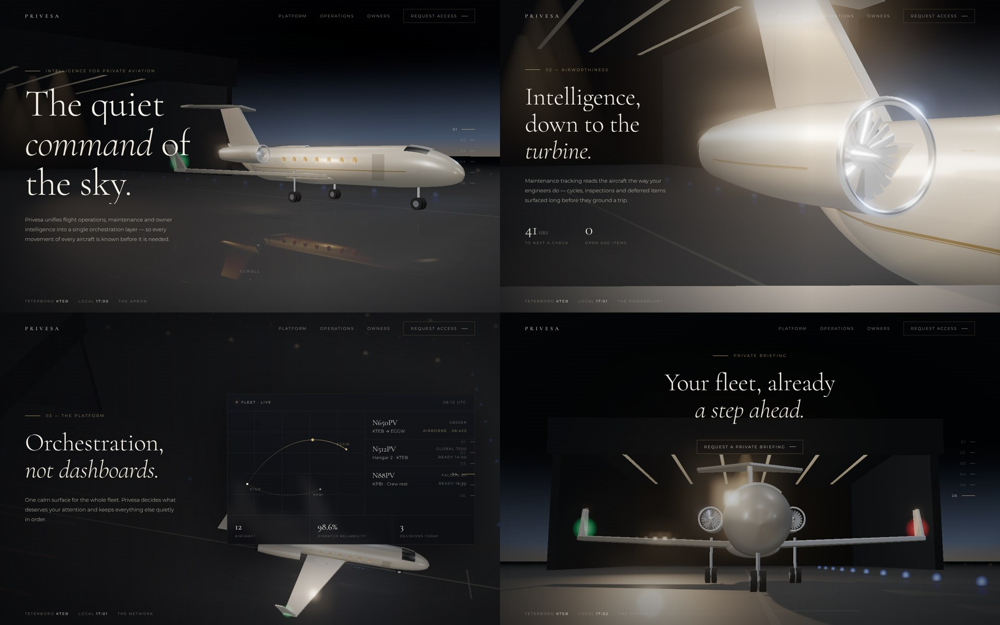

# Privesa — cinematic concept study

A small working concept built before writing the proposal, following the brief: Cormorant Garamond + Montserrat, charcoal / ivory / champagne-gold, a dark hangar at night, and slow scroll-driven camera moves between scenes.



## What it shows

- Apron → cabin → engine close-up → platform → departure, driven by scroll
- Cinematic dip-to-black on the big cut, restrained motion, editorial typography
- Separate portrait framing for mobile and a `prefers-reduced-motion` fallback
- Every scene is a slot: in production, each one takes full-screen footage instead of real-time 3D

## Stack

Three.js · GSAP ScrollTrigger · Lenis — a single `index.html`, no build step. Open it in a browser or serve the folder:

```
npx serve .
```

The production build would live as self-contained components inside an existing Next.js project.
